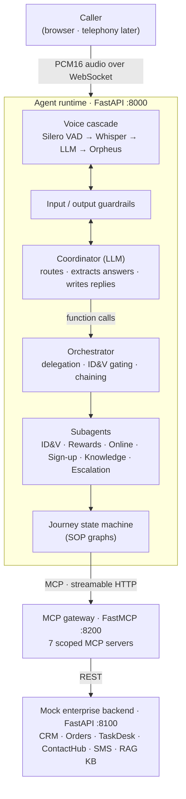

# Callwright

**Real-Time Voice AI Agent for Contact Centers**

Callwright turns standard operating procedure (SOP) flowcharts into natural phone conversations.


> **Demo client:** FreshCart is a fictional retailer. All brands, systems, people, accounts and orders in this
> project are demo data. Swap in your own SOP journeys and backend to point Callwright at a real contact centre.

In the FreshCart demo, the agent handles FreshCart Rewards journeys (points balance, disputes, fraud, history, new card sign-up) and
FreshCart Online journeys (order verification, delivery status, refunds). Each journey is encoded directly from
the contact centre's standard operating procedure (SOP) flowcharts.

> **The AI understands and speaks; deterministic code decides.**
> One LLM listens, routes and writes the reply. Every business decision (identity checks, eligibility, refunds,
> transfers) is made by code that follows the SOP, through least-privilege MCP tools.

---

## Highlights

- **Low-latency voice cascade on Groq:** Silero VAD → Whisper STT → LLM coordinator → Orpheus TTS, streamed
  sentence by sentence, with barge-in.
- **Deterministic SOP execution:** each flowchart is a typed journey graph (questions, rules, tool calls, outcomes)
  that a state machine runs step by step. It never improvises a policy.
- **Coordinator + subagents:** one LLM coordinator; specialist subagents (ID&V, Rewards, Online, Sign-up,
  Knowledge, Escalation) run their journeys in parallel, with ID&V shared once per call.
- **Least privilege through MCP:** each subagent can only reach the MCP servers its journeys need. This is enforced
  by URL, not by prompt.
- **Guardrails on both sides:** input rails check every customer turn, and output rails check every sentence
  *before* it is synthesised, so blocked content is never spoken.
- **Live "agent floor" UI:** watch handoffs, SOP progress, tool calls, guardrails and latency in real time.

## Architecture



| Component | Role | Code |
|---|---|---|
| **Voice cascade** | Turn taking, barge-in, speech to text, streamed text to speech | `services/agent_runtime/cascade.py` |
| **Coordinator** | The only chat LLM. Calls 4 functions: `route_request`, `submit_answer`, `transfer_to_colleague`, `end_call` | `services/agent_runtime/tools.py`, `prompts/voice_agent.md` |
| **Guardrails** | Input and per-sentence output checks (PII, grounding, safety) | `services/agent_runtime/guardrails.py` |
| **Orchestrator** | Delegates to subagents, gates on ID&V, runs journeys in parallel, chains follow-ups, owns the pending question | `services/agent_runtime/orchestrator.py` |
| **Subagents** | Deterministic specialists, one per domain per call, each with its own scoped toolbox and domain notes | `services/agent_runtime/subagents.py`, `prompts/subagent_*.md` |
| **Journey state machine** | Runs SOP flowcharts expressed in a small Python DSL | `services/agent_runtime/journeys/` |
| **MCP gateway** | Exposes the backend as scoped MCP servers | `services/mcp_gateway/server.py` |
| **Mock backend** | Systems of record plus a Chroma RAG knowledge base | `services/mock_backend/` |
| **Agent floor UI** | Live visualisation of the call | `frontend/` |

### MCP servers

| Server | Path | Tools for | Used by |
|---|---|---|---|
| `member_identity` | `/member_identity/mcp` | Rewards account lookup and ID&V | ID&V |
| `order_verification` | `/order_verification/mcp` | Online order number, phone and postcode checks | ID&V |
| `loyalty_accounts` | `/loyalty_accounts/mcp` | Balance, transactions, vouchers, account actions | Rewards |
| `order_service` | `/order_service/mcp` | Order status, refund SMS links | Online |
| `member_enrolment` | `/member_enrolment/mcp` | New member registration, app/web links | Sign-up |
| `case_management` | `/case_management/mcp` | TaskDesk tasks, fraud cases, warm transfers | ID&V, Rewards, Online, Escalation |
| `knowledge_base` | `/knowledge_base/mcp` | Knowledge Base search and policy documents (RAG) | Rewards, Online, Sign-up, Knowledge |

Every server also exposes `log_contact_outcome`, because every journey ends by logging to CRM.

## Getting started

**Prerequisites:** Python 3.12, [uv](https://docs.astral.sh/uv/), Node.js 18+, and a
[Groq API key](https://console.groq.com) (needed only for live calls, not for tests).

### macOS / Linux

```bash
uv venv .venv --python 3.12
uv pip install --python .venv/bin/python -r requirements.txt
cp .env.example .env                                # set GROQ_API_KEY
(cd frontend && npm install)
PATH="$PWD/.venv/bin:$PATH" ./scripts/run_all.sh    # UI → http://localhost:5173
```

### Windows

```powershell
uv venv .venv --python 3.12
uv pip install --python .venv\Scripts\python.exe torch --index-url https://download.pytorch.org/whl/cpu
uv pip install --python .venv\Scripts\python.exe -r requirements.txt
copy .env.example .env                              # set GROQ_API_KEY
.\scripts\run_all.ps1                               # http://localhost:8000   (.\scripts\stop_all.ps1 to stop)
```

`run_all` starts four processes:

| Service | Port |
|---|---|
| Mock backend | 8100 |
| MCP gateway | 8200 |
| Agent runtime (API + WebSocket) | 8000 |
| Frontend (Vite dev server) | 5173 |

All settings (models, voice, VAD timing, guardrails, timeouts) are documented in [`.env.example`](.env.example).

## Testing

```bash
.venv/bin/python -m pytest -q        # 196 tests, no Groq key needed
```

The tests never simulate an LLM. They call the coordinator's tool handlers with the arguments a model would send,
and run them against the real journey engine, the real MCP gateway and the real backend.

End-to-end tools that place real calls through the running stack and Groq:

```bash
python scripts/call_sim.py online --text   # scripted call: online | rewards | fraud | safety
python scripts/scenarios.py                # 40+ scenarios with safety checks → logs/test_results.jsonl
```

Spoken (audio) mode for both tools uses the Windows speech engine; `--text` works on any OS.

A manual test plan with demo data and expected results is in [`docs/TEST_SCRIPT.md`](docs/TEST_SCRIPT.md).

## Project structure

```
├── services/
│   ├── agent_runtime/      # cascade, coordinator tools, guardrails, orchestrator, subagents
│   │   └── journeys/       # SOP journeys (DSL, state machine, registry)
│   ├── mcp_gateway/        # scoped MCP servers (FastMCP)
│   └── mock_backend/       # CRM, orders, TaskDesk, ContactHub, SMS, RAG knowledge base
├── prompts/                # coordinator prompt and subagent domain notes (markdown)
├── frontend/               # React + Vite agent floor UI
├── tests/                  # pytest suite
├── scripts/                # run/stop scripts, live call simulator, end-to-end scenario runner
├── deploy/azure-vm/        # systemd units, nginx config, VM setup script
├── docs/                   # CONTEXT.md (design source of truth), TEST_SCRIPT.md
└── .github/workflows/      # CI: pytest + frontend build
```

## Deployment

To deploy on an Ubuntu VM (systemd + nginx), see [`deploy/azure-vm/setup.sh`](deploy/azure-vm/setup.sh).

## Documentation

Start with [`docs/CONTEXT.md`](docs/CONTEXT.md). It is the source of truth for the design decisions, the
architecture, what is verified and what is left to do.

## License

Released under the [MIT License](LICENSE).
